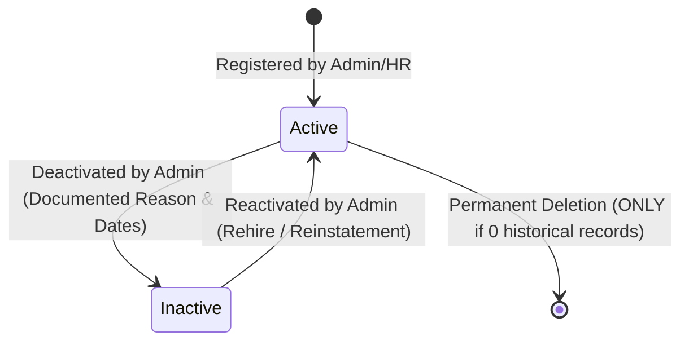

# Saylani HCM Lite - Human Capital Management System

Production-quality Human Capital Management (HCM) application designed for Saylani Welfare International Trust with biometric face verification, atomic persistence, role-based access control (RBAC), and employee status lifecycle management.

---

## 1. Employee Status Lifecycle & Management

Employees transition through a managed lifecycle enforcing financial, labor, and audit compliance:



### Status Types:
- **`Active`**: Employee is currently employed. Can perform biometric attendance check-in/out, submit leave requests, and is included in monthly payroll calculations.
- **`Inactive`**: Employee has separated (resigned, retired, contract ended, or terminated). Their linked user login is immediately disabled, active tokens are rejected, and restricted operations are blocked. All historical records remain fully preserved and intact.

---

## 2. Employee Deactivation Workflow

### Authorization & RBAC
- **Permitted Role**: **Administrator (`admin`) ONLY**.
- **HR Officers (`hr`) and Employees (`employee`)**: Strictly forbidden with server-enforced `403 Forbidden`.

### Step-by-Step Workflow:
1. **Pre-check Safety Validation (`GET /api/employees/:id/deactivation-precheck`)**:
   Before confirming deactivation, the server scans the employee's pending responsibilities and alerts the Admin to:
   - **Pending Leave Requests**: Flags pending leave applications requiring approval or cancellation.
   - **Unprocessed Draft Payroll Runs**: Warns if the employee is included in an unfinalized monthly payroll run.
   - **Open Attendance Sessions**: Identifies unclosed attendance sessions today (e.g. checked in with missing check-out).
   - **Biometric Templates**: Reports whether face biometrics are enrolled in the secure vault.
2. **Separation Documentation**:
   The Admin records:
   - **Effective Deactivation Date** (`YYYY-MM-DD`): Date status changes.
   - **Final Working Date / Relieving Date** (`YYYY-MM-DD`): Documented last day on duty.
   - **Separation Category**: Voluntary resignation, fixed-term contract expiration, involuntary separation, retirement, relocation, etc.
   - **Primary Reason & Remarks**: Detailed documented explanation.
   - **Rehire Eligibility**: Boolean flag documenting whether the employee is eligible for future re-employment.
3. **Server-Side Enforcement (`POST /api/employees/:id/deactivate`)**:
   - `employee.status` is set to `'inactive'`.
   - Linked user account `user.isActive` is set to `false`.
   - Any currently issued JWT session tokens are immediately rejected on the server on their next request.
   - Audit log entry `EMPLOYEE_DEACTIVATED` is written to the immutable audit trail.

---

## 3. Immediate Session Revocation & Operation Blocking

Deactivation is enforced authoritatively on the server, not just cosmetically in the UI:

| Protected Operation | Active Employee | Deactivated Employee | Server Response |
| :--- | :---: | :---: | :--- |
| **User Sign-In (`POST /api/auth/login`)** | Allowed | Blocked | `401 Unauthorized` |
| **Protected API Call (`authenticateToken`)** | Allowed | Blocked | `401 Unauthorized` |
| **Attendance Check-In (`POST /api/attendance/check-in`)** | Allowed | Blocked | `403 Forbidden` |
| **Attendance Check-Out (`POST /api/attendance/check-out`)** | Allowed | Blocked | `403 Forbidden` |
| **Fallback Attendance (`POST /api/attendance/fallback-request`)** | Allowed | Blocked | `403 Forbidden` |
| **Submit Leave Request (`POST /api/leaves`)** | Allowed | Blocked | `403 Forbidden` |
| **Face Biometric Enrollment (`POST /api/biometrics/enroll`)** | Allowed | Blocked | `403 Forbidden` |
| **Resend Activation Invite (`POST /api/employees/:id/resend-invite`)** | Allowed | Blocked | `400 Bad Request` |

---

## 4. Historical Records Preservation & Payroll Safety

Deactivating an employee **never deletes or modifies historical records**:
- **Attendance Records**: Retained permanently in `attendance[]`. Filterable and visible in attendance history and daily logs.
- **Leave Records**: Preserved permanently in `leaves[]`.
- **Payroll & Payslip Records**:
  - Finalized payrolls remain strictly immutable.
  - Deactivation does not corrupt historical calculations or salary figures.
  - When generating payroll for a target month (`POST /api/payroll/generate`), active employees as well as employees deactivated *during* that month (whose `deactivationDate` or `finalWorkingDate` falls within the month) are included for final settlement and payment calculation.
- **Audit Trail**: Append-only log entries document all lifecycle events.

---

## 5. Employee Reactivation Workflow

### Authorization & RBAC
- **Permitted Role**: **Administrator (`admin`) ONLY**.

### Reactivation Rules:
1. If the employee was previously marked *ineligible for rehire* (`rehireEligible: false`), the UI presents a prominent warning advising Admin discretion before proceeding.
2. Admin enters the **Reactivation Effective Date** and **Documented Reason** (e.g. approved rehire application, contract renewal).
3. The server (`POST /api/employees/:id/reactivate`):
   - Sets `employee.status = 'active'`.
   - Records `reactivationDate` and `reactivationReason`.
   - Restores the linked user account `user.isActive = true`.
   - Preserves the existing `employeeCode`, ID, and all historical relationship records.
   - Writes an `EMPLOYEE_REACTIVATED` audit entry.
4. The employee can immediately log in with their existing credentials.

---

## 6. Deletion Policy & Referential Integrity Rules

Saylani HCM Lite enforces strict financial and audit compliance to prevent accidental or malicious data loss:

### Deletion Restrictions:
- Permanent deletion (`DELETE /api/employees/:id`) is **STRICTLY PROHIBITED** if the employee has **ANY** historical records:
  - Any Attendance record (`attendanceCount > 0`)
  - Any Leave record (`leavesCount > 0`)
  - Any Payroll / Payslip record (`payrollCount > 0`)
  - Any Fallback attendance request (`fallbackCount > 0`)
- Attempting to delete an employee with historical records results in `409 Conflict`:
  > *"Cannot delete employee EMP-0001: Employee has historical business records (1 attendance record(s), 1 leave record(s)). Referential integrity, financial audit trails, and labor compliance require deactivation instead of permanent deletion."*

### When Deletion is Permitted:
- Allowed **ONLY** for newly registered test or accidental employee entries with **zero historical records**.
- Requires:
  1. Server authorization: **Admin role only**.
  2. Explicit confirmation: `confirmation: true` in request body.
  3. Clean removal of biometric vault templates and linked user account.
  4. Non-silent execution: Logs an `EMPLOYEE_DELETED` audit entry preserving actor, timestamp, employee code, and email.

---

## 7. Role-Based Access Control (RBAC) Permissions Matrix

| Permission / Action | Admin (`admin`) | HR Officer (`hr`) | Employee (`employee`) |
| :--- | :---: | :---: | :---: |
| View Employee Directory | Yes (Full + Salaries) | Yes (Full + Salaries) | Yes (Colleague Salaries Masked) |
| Register New Employee | Yes | Yes | No |
| Resend Invitation Link | Yes | Yes | No |
| **Deactivate Employee** | **Yes** | **No** (403) | **No** (403) |
| **Reactivate Employee** | **Yes** | **No** (403) | **No** (403) |
| **Delete Employee (0 records)** | **Yes** | **No** (403) | **No** (403) |
| Attendance Check-In / Out | Yes | Yes | Yes (Active Only) |
| Approve Leaves | Yes | Yes | No |
| Generate Draft Payroll | Yes | Yes | No |
| Finalize Payroll Run | Yes | No (403) | No (403) |
| View Security Audit Logs | Yes | No (403) | No (403) |
| Update Organization Settings| Yes | No (403) | No (403) |

---

## 8. Automated Test Suite

Run the full verification suite covering all 8 test groups:

```bash
npm test
```

### Verified Test Groups:
1. **Setup & Authentication**: Initial admin account creation, JWT issuance, credential hashing.
2. **Employee Registration**: Automatic linked user account provisioning with least-privileged role.
3. **Data Isolation & Privacy**: Salary masking for non-privileged colleagues.
4. **Biometric Vault**: 128D facial vector validation, AES-256-GCM encryption at rest.
5. **Biometric Verification Math**: Euclidean distance matching and single-use proof token anti-spoofing.
6. **Attendance Business Rules**: PKT timezone evaluation, lateness calculation, half-day threshold.
7. **Fallback & Consent**: Authorized fallback requests and biometric template deletion.
8. **Employee Lifecycle, Deactivation, Reactivation & Safety**:
   - Deactivation pre-check warnings (pending leaves & draft payroll)
   - RBAC enforcement (HR deactivation blocked with 403)
   - Admin deactivation recording effective dates, separation reasons, and rehire eligibility
   - Immediate login blocking and token revocation
   - Operation blocking for attendance and leaves
   - Historical records and payroll preservation
   - Referential integrity deletion restrictions (409 Conflict)
   - Administrative reactivation and linked account restoration
   - Clean deletion of record-free employee with explicit confirmation
   - Audit trail completeness verification
