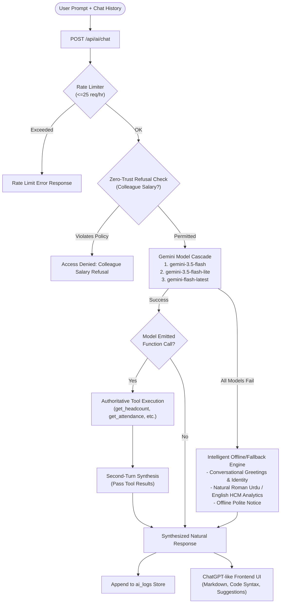

# Saylani HCM Lite — AI Assistant Architecture & Audit Specification

**Target:** `server/ai.ts`, `server/api.ts`, `src/components/AIAssistantModal.tsx`  
**Date:** October 27, 2026  
**Auditor / Architect:** Senior AI Systems Architect & Full-Stack Security Engineer  

---

## 1. Executive Summary & Problem Diagnosis

Saylani HCM Lite features an embedded AI assistant designed to provide conversational self-service and HR intelligence across English, Urdu, and Roman Urdu.

Prior to this architectural overhaul, users observed that the assistant would frequently repeat its static welcome message rather than answering ordinary questions (such as `"hi"`, `"tum kon ho?"`, `"Aj kitne log present hain?"`, or general queries like `"what do you think of my company?"`).

### Verified Root Causes

1. **Model Quota Exhaustion & Lack of Fallback Cascade**:
   - The server was configured with `gemini-3.8-flash` as default. On Google AI Studio Free Tier, `gemini-3.8-flash` enforces a strict 20 requests/day quota (`GenerateRequestsPerDayPerProjectPerModel-FreeTier`) or returns `503 Service Unavailable` during high-demand spikes.
   - When this call failed, the exception was caught by `catch (err)` and silently redirected to `runFallback()`.
   - No failover cascade (e.g. `gemini-3.5-flash`, `gemini-3.5-flash-lite`, `gemini-flash-latest`) was attempted.

2. **Brittle Fallback Regex & Default Catch-All**:
   - In `runFallback()`, intent detection was limited to a few specific English/Roman Urdu words (e.g., checking only `lowerPrompt.includes('attendance')` or `lowerPrompt.includes('hajri')`).
   - The natural Roman Urdu question `"Aj kitne log present hain?"` contains neither `'attendance'` nor `'hajri'`, so it bypassed the attendance branch.
   - Conversational inputs (`"hi"`, `"salam"`, `"tum kon ho?"`, `"who are you"`, general coding or writing questions) had no matching handler and fell directly through to the bottom-most return:
     ```typescript
     return {
       answer: `Hello ${user.fullName || user.email}! I am your Saylani HCM Lite AI Assistant...`
     };
     ```
   - This caused the exact symptom reported: repetitive welcome messages on ordinary questions.

3. **Restricted System Prompt**:
   - The previous system instruction instructed the model that it was *only* an HCM assistant and lacked guidance to engage in general-purpose problem solving (such as programming, math, translation, and communication) when requested by the user.

4. **Missing Multi-Turn Conversation History**:
   - The frontend only dispatched `{ prompt: string }` and the backend `processAIChat` received only `userPrompt: string`.
   - Follow-up questions (e.g., `"Explain Python loops"` followed by `"Give me an example"`, or `"How many are late today?"` followed by `"Who are they?"`) had no memory of prior turns.

---

## 2. Target Architecture

The transformed architecture provides a dual-capability intelligence layer:
1. **General-Purpose Conversational Engine (ChatGPT-grade)**: Capable of assisting with coding (Python, JavaScript, TypeScript, SQL), drafting professional emails, explaining complex concepts, performing translations, math, and answering open-ended inquiries.
2. **Authoritative HCM Tool Integration**: Grounded in Saylani HCM Lite's database with strict Role-Based Access Control (RBAC).



---

## 3. Tool Inventory & Permission Scoping

| Tool Name | Parameters | Allowed Roles | Data Scope |
| :--- | :--- | :---: | :--- |
| `get_headcount` | `department?: string` | Admin, HR | Active count, total registered count |
| `get_attendance_summary` | `date?: string` | All (Scoped) | Admin/HR: Company-wide metrics. Employee: Self record only |
| `get_late_comers` | `date?: string` | Admin, HR | List of employees arriving after grace period |
| `get_frequent_late_comers`| `month?: number, year?: number` | Admin, HR | Top late arrivals this month |
| `get_leave_summary` | none | Admin, HR | Pending count, approved count, on-leave today |
| `get_my_leave_balance` | none | All (Employee Profile) | Personal quota, used, and remaining balances |
| `get_payroll_summary` | `month?: number, year?: number` | Admin, HR | Gross, tax, net totals, employee count |
| `search_employees` | `query: string` | All (Scoped) | Admin/HR: Full details. Employee: Directory contact only |
| `parse_smart_leave` | `leaveType, startDate, endDate, reason` | All | Computes working days excluding weekends/holidays |

---

## 4. Multi-Turn Conversation Protocol

The client now sends the message history array:
```typescript
interface ChatMessage {
  role: 'user' | 'assistant';
  content: string;
}

interface AIChatRequest {
  prompt: string;
  history?: ChatMessage[];
}
```
The backend maps `history` into Gemini `Content[]` structures, capping history to the last 10 messages (5 turns) to prevent token bloat while maintaining context continuity.

---

## 5. Security & Zero-Trust Enforcement

1. **Independent Server-Side Authorization**: The LLM cannot grant itself permissions. Tools verify `user.role` and `user.employeeId` inside their execution closures.
2. **Zero-Trust Refusal**: Queries from employees requesting peer compensation (in English, Urdu, or Roman Urdu) trigger immediate refusal before tool invocation and are logged in `ai_logs`.
3. **Data Sanitization**: Tool responses return plain objects; employee queries never receive salary fields.
4. **Rate Limiting**: Enforced per user ID in-memory (25 requests/hour).
